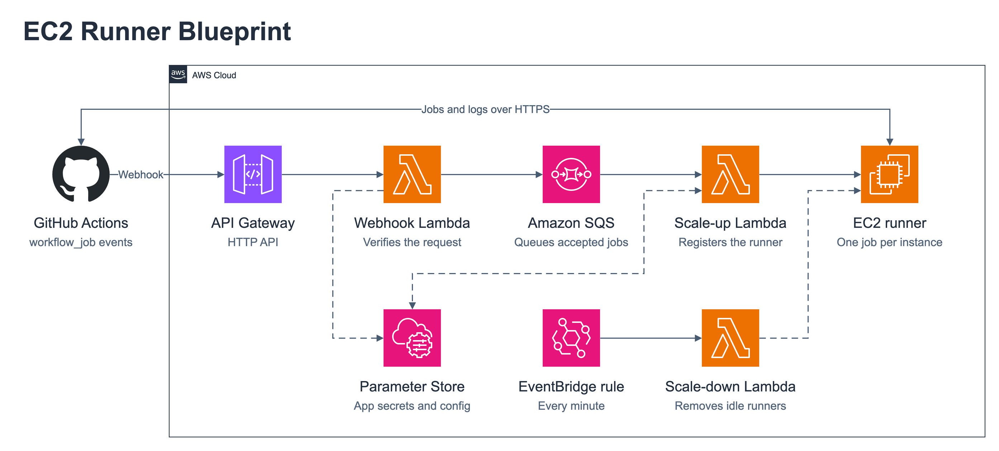

# EC2 Runner Blueprint

A self-managed RunsOn alternative for Linux GitHub Actions on EC2. The template
includes a Terraform module, a Terragrunt example, and a smoke test. AWS bills the
infrastructure directly, and there's no separate runner subscription.



The fleet has zero warm runners, uses On-Demand capacity, and starts with provisioning disabled.
The launch template uses IMDSv2 and encrypted gp3. GitHub App secrets live in SSM SecureString.

## Set up a fleet

1. Select **Use this template** on GitHub and clone the new repository. Install
   Terraform, Terragrunt, Python 3 and the GitHub CLI. Run
   `python3 scripts/fetch_lambdas.py` from the repo root. It verifies the upstream release
   hashes and GitHub attestations. [Pinned release](https://github.com/github-aws-runners/terraform-aws-github-runner/releases/tag/v8.1.1)
2. Create a GitHub App for a trusted private repository. Follow the upstream App permissions
   and subscribe to **Workflow job**. Install it on the one repository you plan to use.
   Store its ID, base64-encoded private key and webhook secret as SecureString parameters
   under `/aws-ci/github-app/` using the names shown in the example. Use the same Region
   as the fleet. [Upstream GitHub App setup](https://github-aws-runners.github.io/terraform-aws-github-runner/getting-started/)
3. Use an existing VPC with outbound access to GitHub and AWS. The example selects
   Amazon Linux 2023 x86_64 at plan time. Set `RUNNER_AMI_ID` to pin a compatible AMI
   and set `RUNNER_AMI_OWNER_ID` if it belongs to another account.
   The example stores local state next to `terragrunt.hcl`, outside its cache.
   Set up an encrypted remote backend for shared deployments.

   ```sh
   cd examples/terragrunt
   cp config.example.sh config.local.sh
   ```

   Fill in `config.local.sh`, then run:

   ```sh
   source ./config.local.sh
   aws sts get-caller-identity --query Account --output text
   terragrunt init
   terragrunt plan
   ```

4. Review and apply the plan. Set the App webhook URL from
   `terragrunt output -raw webhook_url`, activate it and confirm delivery. Export
   `RUNNER_PROVISIONING_ENABLED=true`, review the next plan and apply it.
5. Run **AWS runner smoke** from the default branch of the repository the App
   watches. Copy the workflow there if it's a different repository. Confirm the
   Linux and Docker checks succeed and the EC2 instance terminates. If you change
   the fleet name, use the labels from `terragrunt output -json runner_labels`.
   [Smoke workflow](.github/workflows/runner-smoke.yml)

Keep untrusted PRs on GitHub-hosted runners. For public repositories, use a
separate design with explicit workload isolation. [GitHub runner security](https://docs.github.com/en/actions/reference/security/secure-use#hardening-for-self-hosted-runners)

## Check the module

After downloading the Lambda archives, run `terraform init -backend=false` and
`terraform test` from the root. The tests use mocked AWS resources and were
verified with Terraform 1.16.4.

## Image updates

The default image can change on a new Terraform plan. Pin a custom AMI to control
when the fleet image changes. This template applies image changes through Terraform.
